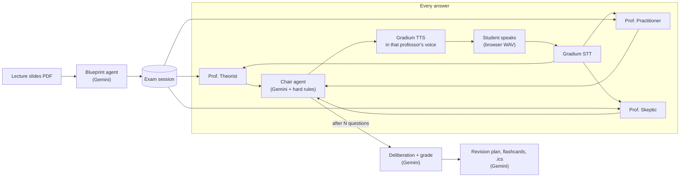

# Viva 🎓

**Rehearse your oral exam out loud, against a panel of three AI professors who have read your lecture slides.**

Oral exams decide grades at many Swiss and European universities, yet students usually prepare alone with written notes. Nobody asks them follow-up questions out loud, notices when they talk around a gap, or tells them which topics are weak before the real exam. Viva fixes that. Upload your slides, pick your exam date, and answer questions by voice. Three professor agents judge every answer in parallel, a chair agent decides who pushes next, and each professor speaks in their own voice. At the end the panel deliberates, agrees on a grade on the Swiss 1–6 scale, and hands you a revision plan, flashcards and a calendar file running up to your exam.

Built at the **{Tech: Europe} Agentic AI Hack, Zürich** with **Google Gemini** (all reasoning), **Gradium** (speech-to-text and text-to-speech) and **Entire** (agent session history).

## How it works



1. **Blueprint.** Gemini reads the PDF natively (including image-heavy slides) and returns a structured exam blueprint: topics, key concepts, what a strong answer contains, common misconceptions and slide references.
2. **The panel.** For every answer, three professor agents run **concurrently** (`asyncio.gather`), each with its own persona. Each sees the blueprint, the actual slide text for the current topic, and the transcript, and returns structured JSON: score, gaps, a **bluff signal**, a proposed follow-up, urgency, and a vote to move on.
   - **Prof. Theorist**: definitions, derivations, "why does this hold?". Rigorous and calm.
   - **Prof. Practitioner**: "give me a concrete example". Warm but demanding.
   - **Prof. Skeptic**: catches vague, hedged or bluffed answers and pushes on them. Dry and sharp.
3. **The chair.** It reads the three assessments and writes the next spoken question. Hard rules are enforced **in code**, so the exam stays predictable even if a model drifts:
   - the Skeptic takes the floor when any bluff signal is above 0.6;
   - no professor speaks three turns in a row;
   - the topic moves on when two or more professors vote to, or after two questions on it;
   - the exam ends after the chosen number of questions.
4. **Voice.** The browser records 16-bit mono WAV, Gradium transcribes it, and the next question is streamed back from Gradium TTS in the speaker's own voice.
5. **Deliberation and report.** The panel argues briefly, in character, and settles on a grade (Swiss 1–6, 0.25 steps, 4 = pass, rounded and clamped in code). The report leads with strengths, then gives per-topic feedback, a dated revision plan up to the exam, flashcards for weak topics, and an RFC 5545 `.ics` calendar file.

## Partner technologies

| Tech | How Viva uses it |
| --- | --- |
| **Google Gemini** (`google-genai`) | Every reasoning step, all with structured JSON output validated by pydantic: the blueprint (reads the PDF natively), the three professors, the chair, the deliberation and grade, and the revision plan with flashcards. A fallback chain across `gemini-3.8-flash`, `gemini-3.6-flash` and `gemini-3.5-flash-lite` handles 503 overloads and per-model 429 quotas automatically. |
| **Gradium** | Speech-to-text for every spoken answer (`/post/speech/asr`, English and German) and text-to-speech for every question (`/post/speech/tts`), with **three distinct voices per language**, one per professor. TTS audio is streamed to the browser as it is generated. |
| **Entire** | Records our Claude Code agent sessions alongside each commit as checkpoints on the `entire/checkpoints/v1` branch, so the full history of how this project was built is browsable on entire.io. |

**Professor voices** (Gradium flagship voices, configurable in `.env`):

| Professor | English | German |
| --- | --- | --- |
| Theorist | Garrett (US, low and calm) | Resi (Bavarian, measured) |
| Practitioner | Saoirse (Irish, warm) | Sophie (Austrian, warm) |
| Skeptic | Elodie-Rose (British, crisp) | Leon (German, bright) |

## Run it locally

**Prerequisites:** Python 3.11+ with [uv](https://docs.astral.sh/uv/), Node 20+, a [Gemini API key](https://aistudio.google.com/apikey) and a [Gradium API key](https://gradium.ai). Use Chrome or Edge for the microphone.

```bash
git clone https://github.com/jumainahkhan/viva.git
cd viva
cp .env.example .env          # then fill in GEMINI_API_KEY and GRADIUM_API_KEY

# Build the frontend once
cd frontend && npm install && npm run build && cd ..

# Run the backend; it also serves the built frontend
cd backend && uv sync && uv run uvicorn main:app --port 8077
```

Open **http://localhost:8077**. A sample lecture is in `samples/intro_ml_lecture.pdf`.

**Frontend development with hot reload:** keep the backend running, then `cd frontend && npm run dev` and open http://localhost:5173 (it proxies `/api` to port 8077).

**Backup demo without audio or browser:**

```bash
cd backend
uv run python scripts/cli_exam.py ../samples/intro_ml_lecture.pdf --questions 4 --report   # add --de for German
uv run python scripts/gradium_smoke_test.py   # checks every voice + STT round trip
```

## API

| Method and path | Request | Response |
| --- | --- | --- |
| `GET /api/health` | none | Status, configured keys, model names |
| `POST /api/session` | multipart: `pdf`, `exam_date` (YYYY-MM-DD, optional), `num_questions` (2–10), `language` (`en` or `de`) | `session_id`, blueprint, professors, first `turn` |
| `POST /api/session/{id}/answer` | multipart: `audio` (WAV) **or** `text`, or `skip=true` | `transcript`, three `assessments`, next `turn`, `timings` |
| `POST /api/session/{id}/report` | none | `report` (deliberation, grade, strengths, per-topic feedback, weakest topics), `plan` (sessions, flashcards), `ics_url` |
| `GET /api/session/{id}/calendar.ics` | none | `text/calendar` revision plan, `Europe/Zurich`, sessions at 18:00 |
| `GET /api/audio/{audio_id}.wav` | none | The question audio, streamed from Gradium on first request and cached for replay |

A `turn` is `{speaker, question, topic_id, topic_title, reasoning, audio_url, question_number, total_questions, end_exam}`.

## Project layout

```
backend/
  main.py              FastAPI routes
  config.py            env vars, models, voices
  schemas.py           pydantic models (also Gemini response schemas)
  gemini_client.py     structured output + model fallback chain
  gradium_client.py    STT, TTS (buffered and streaming), voice list
  exam.py              in-memory ExamSession and turn orchestration
  agents/              blueprint, professors, chair, deliberation, revision (+ .ics)
  scripts/             gradium_smoke_test, cli_exam, test_blueprint, make_sample_pdf
frontend/src/
  Setup.tsx, Exam.tsx, Report.tsx, recorder.ts (WAV capture), api.ts
samples/intro_ml_lecture.pdf
```

## Built with

- **AI and voice:** Google Gemini via `google-genai`; Gradium STT and TTS REST APIs
- **Backend:** Python 3.11, FastAPI, Uvicorn, Pydantic v2, httpx, pypdf, python-dotenv, python-multipart, uv
- **Frontend:** React 19, TypeScript, Vite, Tailwind CSS v4, Web Audio API (WAV capture), Google Fonts (Fraunces, Plus Jakarta Sans)
- **Dev workflow:** Claude Code, Entire CLI, Git and GitHub; ReportLab to generate the sample lecture

## Limitations and next steps

- **Push-to-talk, not streaming.** Gradium STT over REST runs at roughly half real time, so a 20-second answer takes about 10 seconds to transcribe. Next step: stream microphone audio to Gradium's WebSocket STT while the student speaks, so the transcript is ready the moment they stop.
- **In-memory sessions.** Restarting the server clears exams. Next step: persist sessions and track progress across mock exams.
- **Gemini free-tier limits.** The Pro model has no quota on a free key, so all agents run on the Flash family. A paid key would let the blueprint and final grade use Pro.
- **Concurrency.** The Gradium account allows two concurrent sessions, so the server queues extra STT and TTS requests.
- **Grounding** relies on slide text and Gemini's PDF reading. Slides that are mostly diagrams give thinner blueprints.
- Ideas: interruptions and barge-in, per-professor difficulty settings, sharing a mock exam with a study group, and more exam languages (Gradium also offers French voices).
